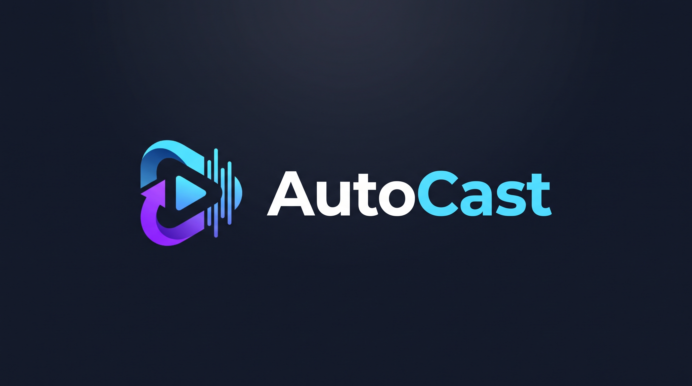

# AutoCast

<p align="center">
  
</p>

AutoCast is an automated desktop application designed for streamlined content generation, audiovisual synthesis, and automated publication scheduling to YouTube Studio.

## Architecture

The project is structured into modular components:

- `main.py`: Desktop graphical user interface built with CustomTkinter.
- `story_generator.py`: Script generation engine powered by Gemini 2.5 Flash, generating multi-act narrative scripts, titles, descriptions, and tags.
- `studio_worker.py`: Headless browser automation layer via Playwright managing persistent session authentication, workspace synthesis, and video export.
- `youtube_uploader.py`: YouTube Data API v3 client managing chunked media upload, metadata tagging, COPPA compliance flags, and release scheduling.
- `config.py`: Local runtime configuration, credential management, and output directory bindings.
- `run.bat`: Windows execution script.

## Directory Layout

```
AutoCast/
|-- assets/               Project assets and branding images
|-- browser_profile/      Local persistent browser storage for session tokens
|-- data/                 OAuth client tokens and authorization cache
|-- output/               Exported MP4 video presentations
|-- config.py             Settings and environment path configuration
|-- main.py               GUI application entry point
|-- run.bat               Windows launcher
|-- story_generator.py    Narrative LLM pipeline
|-- studio_worker.py      Playwright browser automation engine
|-- youtube_uploader.py   YouTube Data API v3 uploader and scheduler
```

## Flexible AI Story Generation Providers

AutoCast is designed to be fully accessible to the open-source community, whether you have official API credits, a CLI coding subscription, or run local models:

1. **Pi Agent Bridge**: Connects to your authenticated terminal agent subscription (such as Gemini 3.8 Flash via Antigravity). Requires zero API tokens or credit card billing.
2. **OpenAI-Compatible Custom Endpoint**: Connect to local models or subscription proxies like **Ollama** (`http://localhost:11434/v1`), **LiteLLM** (`http://localhost:8000/v1`), **LM Studio**, or **Jan.ai**.
3. **Official Google Gemini API Key**: Use direct developer API keys from Google AI Studio.
4. **Manual Mode**: Generates structured prompt templates to copy-paste into any web chat interface (ChatGPT, Claude, Gemini Web) with zero dependencies.

## Setup Instructions

### 1. Prerequisites

- Python 3.10+
- Google Chrome or Chromium browser
- Either an AI generation provider (Pi Agent, local Ollama/LiteLLM, or Gemini API key)
- Google Cloud OAuth 2.0 Desktop Application credentials (`client_secret.json`) with YouTube Data API v3 enabled

### 2. Dependency Installation

Install the required packages using pip:

```bash
python -m pip install playwright customtkinter google-api-python-client google-auth-oauthlib google-auth google-genai
python -m playwright install chromium
```

### 3. Execution

Launch the application using the batch script:

```bat
run.bat
```

Or execute directly with Python:

```bash
python main.py
```

## Operation Workflow

1. **Session Setup**: Click `Setup Cloud Session` in the left sidebar to initialize your persistent browser profile.
2. **Configure API Keys**: Open `Settings`, enter your Gemini API key, link your `client_secret.json`, and set your preferred export directory.
3. **Generate Content**: Under `Generate Story & Video`, select a predefined narrative theme or specify custom prompt directives, then click `1. Generate Story Script`.
4. **Synthesize Media**: Click `2. Synthesize & Export Video` to trigger the cloud synthesis engine and download the finalized `.mp4` video.
5. **Schedule Publication**: Switch to `YouTube Scheduler`, select the generated video file, verify titles and tags, set the release timestamp, and click `Schedule Upload to YouTube`.
